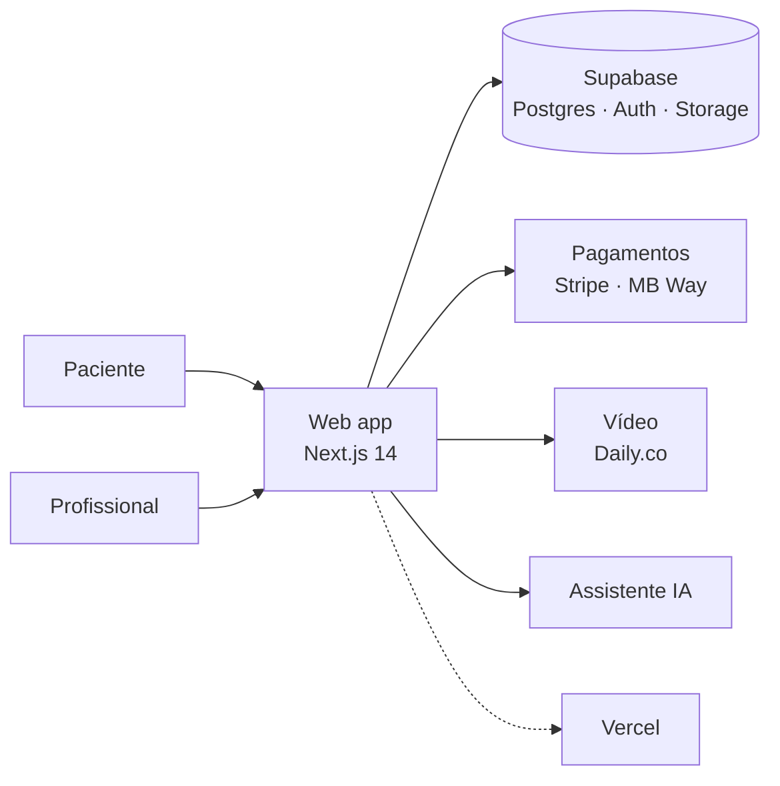

# NSANA

**Cuidados de saúde ao domicílio: o paciente marca, o profissional vai a casa.**

> 🤝 **Plataforma construída e testada, à procura de parceiro** para a levar ao mercado.
> O código-fonte é privado. Este repositório apresenta o produto e a arquitetura.
>
> 👉 [Falar sobre parceria](https://tally.so/r/Gev8VL)

---

## O que é

A NSANA é um marketplace que liga pacientes a profissionais de saúde que prestam cuidados em casa. Foi pensada para Portugal, com o lançamento inicial previsto para Faro.

## Serviços

- Enfermagem
- Fisioterapia
- Medicina
- Psicologia
- Teleconsulta
- Pediatria

## Funcionalidades

- **Painéis dedicados** para pacientes e para profissionais
- **Marcação e pagamento** na plataforma, com Stripe e MB Way
- **Teleconsulta por vídeo** no browser
- **Feed na página inicial**, com conteúdos e espaço para destaques pagos
- **Catálogo clínico** de serviços e preços estruturado em base de dados
- **Assistente com IA** integrado (Claude API)

## Arquitetura

- **Perfis separados** para paciente e profissional, cada um com o seu painel
- **Catálogo clínico** de serviços e preços modelado em PostgreSQL, com a lógica em TypeScript
- **Design system** próprio, em modo escuro, com ícones SVG

## Stack

## Procuramos

Um parceiro que traga **experiência no setor da saúde, rede de contactos ou capital** para o lançamento: registo nas entidades reguladoras, angariação dos primeiros profissionais e chegada ao mercado.

👉 [Falar sobre parceria](https://tally.so/r/Gev8VL) · [Isaac Afonso](https://afonsoisaac57.github.io) · [LinkedIn](https://www.linkedin.com/in/isaac-afonso-a0b0431b1)

---

© Isaac Afonso. Código-fonte privado. Este repositório é apenas uma apresentação do projeto.
